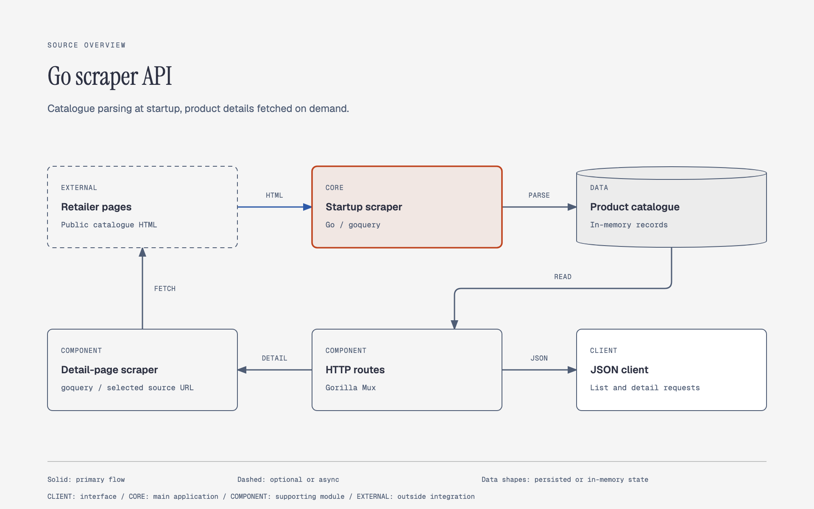

# Go commerce scraper API

A small Go service that parses a retailer's laptop catalogue and exposes the extracted products as JSON.

The startup scrape builds an in-memory list. A product-detail request follows the selected item's source link and parses that page on demand.

## How it works



[Vector diagram](docs/diagrams/architecture.svg) · [Editable HTML](docs/diagrams/architecture.html)

## Run locally

Use Go compatible with `go.mod` (Go 1.21.6 or newer).

```bash
git clone https://github.com/Rokki-Khazratov/go-commerce-scraper-api.git
cd go-commerce-scraper-api
go mod download
go run .
```

The server listens on http://localhost:8080.

```bash
curl http://localhost:8080/api/laptops/
curl http://localhost:8080/api/laptop/1/
```

| Endpoint | Behaviour |
| --- | --- |
| `GET /api/laptops/` | Returns the catalogue collected at startup |
| `GET /api/laptop/{id}/` | Fetches and parses the selected product page |

Catalogue records include title, price, image links and the source URL. Invalid IDs return an error rather than selecting another item.

## Scope

This is a historical scraping prototype. IDs depend on the collected order, records disappear when the process stops, and extraction depends on the retailer's HTML selectors. Check the configured source and selectors before relying on fresh results.

## Stack and code

Go · goquery · Gorilla Mux · rs/cors

`main.go` registers the HTTP routes. `data-scrappers/scrapper/` contains catalogue and detail parsing. The root application is started with `go run .`.
