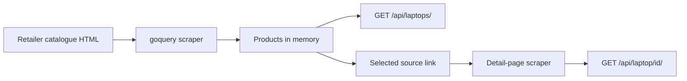

# Go commerce scraper API

A Go prototype that reads a retailer's laptop catalogue and serves the extracted products as JSON.

The application scrapes the catalogue at startup. A list request reads the collected products; a detail request follows the selected product's source link and extracts its details.

## Stack

Go · goquery · Gorilla Mux · rs/cors

## Run locally

Use Go compatible with the version declared in `go.mod`.

```bash
git clone https://github.com/Rokki-Khazratov/scrapped-data-api.git
cd scrapped-data-api
go mod download
go run .
```

The server listens on `http://localhost:8080`.

| Request | Result |
| --- | --- |
| `GET /api/laptops/` | Products collected at startup |
| `GET /api/laptop/1/` | Details scraped from the first product's source page |

The previous README described a `POST /api/parse` endpoint. That route is not registered in the current `main.go`.

## How it fits together



## Scope

This is a historical scraping experiment. Catalogue data is held in memory, product IDs depend on its collected order, and extraction depends on the source site's HTML. The configured retailer and selectors need rechecking before treating the output as current data. No database, scheduled refresh or production availability is claimed.
